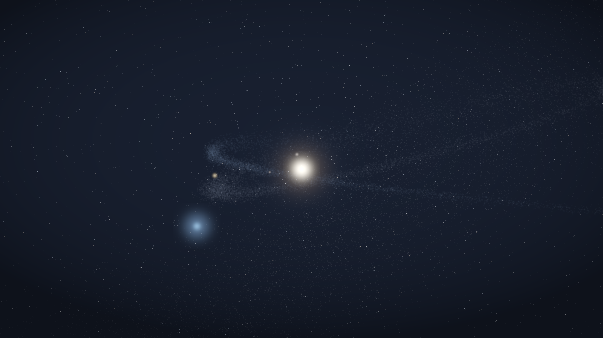

# Meteor Wallpaper

Windows 桌面星空 / 流星雨壁纸。自研 three.js 场景 + .NET 8 WinForms 宿主，
通过 WorkerW 挂到桌面图标下面，绿色便携、纯离线。

每次启动由种子随机生成一个星系：恒星（色温 / 半径）、3–5 颗行星、
0–2 条彗星尘埃带、相机构图全部由 `seed` 推导；托盘可「换一个星系」热重建。



> 上图是 CPU 近似预览，只用于看构图；真实渲染以程序运行为准。

## 下载

到 [Releases](../../releases) 下载 `MeteorWallpaper_v1.7.1.zip`（62 MB，自带 .NET 运行时）：

1. 解压到任意文件夹（中文路径可以）
2. 双击 `MeteorWallpaper.exe`
3. 托盘图标在右下角，可能藏在 `∧` 里；找不到就用同目录的 `关闭壁纸.bat` 关掉

系统要求：Windows 10 1809+ / Windows 11，需要 WebView2 运行时（Win11 自带）。

## 结构

```
src/MeteorWallpaper/           C# 宿主
  Program.cs                   入口（含 --capture / --selftest / --attachtest）
  Tray.cs                      托盘、菜单、种子、状态机、暂停策略
  WallpaperWindow.cs           承载 WebView2 的窗口（桌面层 / 交互层 切换）
  DesktopHost.cs               WorkerW 查找与 SetParent
  WebViewSetup.cs              浏览器参数、虚拟主机、设置
  Settings.cs / SettingsForm.cs 配置与设置窗
  Autostart.cs                 HKCU Run
  QuitSignal.cs                --quit / 二次启动 的跨进程退出信号
  HotkeyWindow.cs              Ctrl+Alt+M
  Native.cs                    Win32 P/Invoke
  wwwroot/                     场景（three.js r160）
    galaxy.js                  种子 -> SystemSpec（纯数据，可在 Node 里跑）
    app.js                     buildScene(spec) + 渲染循环
    index.html / style.css
    three.module.js            本地 three.js
    THREE-LICENSE.txt
tools/                         开发用，不进发布包
  run-scene.mjs                在 Node 里跑 app.js（DOM 打桩），含换种子重建
  check-galaxy.mjs             批量校验 800 个种子是否满足构图约束
  dump-spec.mjs                导出 spec JSON
  preview_spec.py              按 spec 做 CPU 近似渲染（只看构图，颜色不准）
  scene-stub.mjs / serve.js
build.ps1                      发布 + 打包
```

## 构建

```powershell
# 首次：装 SDK 到 .sdk（约 285MB）
powershell -File dotnet-install.ps1 -Channel 8.0 -InstallDir .sdk -NoPath

# 出包：dist\MeteorWallpaper\ 和 dist\MeteorWallpaper_v1.7.1.zip
powershell -File build.ps1
```

注意：`build.ps1` 必须能按 UTF-8 读（里面写死了中文文件名）。脚本开头有自愈守卫：
没有 BOM 就用 UTF-8 重写自己并重启一次，正常情况下不需要管。

## 调试

```powershell
node tools\check-galaxy.mjs 800          # 生成器约束自检
node tools\run-scene.mjs src\MeteorWallpaper\wwwroot .tmp\scene   # 场景执行 + 热重建
node tools\dump-spec.mjs .tmp\specs 12345
python tools\preview_spec.py .tmp\specs\spec-12345.json shots\x.png

# 渲染一帧到 png，用来检查真实画面（需要 WebView2 可用）
MeteorWallpaper.exe --capture out.png --mode solar --seed 12345 --wait 8000
MeteorWallpaper.exe --capture out.png --mode earth --wait 12000
```

日志：`data\meteor.log`（随程序目录）。里面有每次构建的 `scene spec seed=...`。

## 关键实现点

- **WorkerW**：`Progman` 发 `0x052C` → 找 `SHELLDLL_DefView` 的兄弟 `WorkerW`
  → `SetParent` + `WS_CHILD`。Explorer 重启后由 2s 定时器重挂。
- **节流**：Chromium 会把 WorkerW 里的窗口判为 occluded 并停掉 rAF，
  必须带 `--disable-features=CalculateNativeWinOcclusion` 等参数。
- **暂停**：`SHQueryUserNotificationState` 判全屏；`SessionSwitch` 判锁屏；
  离电降到 20fps。
- **交互**：`Ctrl+Alt+M` 时把同一个窗口从 WorkerW 摘出来变成置顶窗口，
  Esc 再挂回去——复用同一个 WebView2，状态不丢。
- **随机星系**：`?seed=N` 进页面；托盘「换一个星系」走 `{cmd:"seed"}`，
  场景就地 dispose 旧对象重建，不重载 WebView。
- **退出兜底**：托盘图标可能被折进 Win11 的 ∧，所以 `关闭壁纸.bat`、
  再双击一次 exe、`--quit` 三条路都能关掉进程（命名事件 `Local\MeteorWallpaper.Quit`）。

## 版权

宿主与场景自研；three.js 为 MIT（`wwwroot/THREE-LICENSE.txt`）。
未使用 meteorshowers.org 的任何代码、图片或文字。
